# <center>文本处理三剑客</center>

## 前置知识

在文本处理领域，**正则表达式**是必过的坎。如果不会正则表达式，则文本处理工作几乎无法正常进行。有关**正则表达式**的使用，可访问[知识库：正则表达式](/Markdown-Notes/?技术栈=通用&笔记=正则表达式)，或是[第三方在线教程](/Tutorials/编程开发/regular-expression.html)。

## `grep` **查找**

### 简介

`grep`即`global regular expression print`，用于在文本中以指定的模式（**正则表达式**）进行搜索。

- 基本语法
  ```bash
  grep [选项] 模式 [文件]  #"grep"默认输出整行
  ```

### 选项

- 匹配控制

  | 选项 | <center>说明</center>              |
  | :--: | ---------------------------------- |
  | `-i` | 忽略大小写                         |
  | `-v` | 反向匹配（显示不匹配的行）         |
  | `-w` | 匹配整个单词                       |
  | `-x` | 匹配整行                           |
  | `-F` | 将模式视为固定字符串（不解释正则） |
  | `-E` | 使用扩展正则表达式（等价于`egrep`  |
  | `-G` | 使用基本正则表达式（**默认**）     |
  | `-P` | 使用 Perl 正则表达式               |

  **_注意_**：如果不用`-E`，这些字符会被当做普通字符处理：`?`、`+`、`|`、`{`、`}`、`(`、`)`。

  ```bash
  #范例
  grep 'apple\|banana' test.txt    #基本正则表达式
  grep -E 'apple|banana' test.txt  #扩展正则表达式

  grep 'apples\?' test.txt    #基本正则表达式
  grep -E 'apples?' test.txt  #扩展正则表达式
  ```

- 输出控制

  |   选项    | <center>说明</center>                                                                                                                             |
  | :-------: | ------------------------------------------------------------------------------------------------------------------------------------------------- |
  |   `-c`    | 只输出匹配的行数                                                                                                                                  |
  |   `-l`    | 只输出包含匹配的文件名                                                                                                                            |
  |   `-L`    | 只输出不包含匹配的文件名                                                                                                                          |
  |   `-o`    | 只输出匹配的部分                                                                                                                                  |
  |   `-q`    | 静默模式，不输出任何内容                                                                                                                          |
  |   `-s`    | 不显示错误信息                                                                                                                                    |
  |   `-h`    | 多文件时不显示文件名                                                                                                                              |
  |   `-H`    | 显示文件名                                                                                                                                        |
  |   `-n`    | 显示行号                                                                                                                                          |
  |   `-b`    | 显示字节偏移量                                                                                                                                    |
  | `--color` | `--color`（相当于`--color=auto`）<br> `--color=auto`（输出到终端时高亮，**默认**）<br>`--color=always`（始终高亮）<br>`--color=never`（从不高亮） |

- 上下文控制

  |  选项  | <center>说明</center>       |
  | :----: | --------------------------- |
  | `-A n` | 显示匹配行及其**后n行**     |
  | `-B n` | 显示匹配行及其**前n行**     |
  | `-C n` | 显示匹配行及其**前后各n行** |

- 目录与文件

  |        选项         | <center>说明</center>        |
  | :-----------------: | ---------------------------- |
  |        `-r`         | 递归搜索目录                 |
  |        `-R`         | 递归搜索目录（跟随符号链接） |
  |  `--include=GLOB`   | 只搜索匹配的文件             |
  |  `--exclude=GLOB`   | 排除匹配的文件               |
  | `--exclude-dir=DIR` | 排除目录                     |
  |        `-a`         | 将二进制文件当作文本处理     |
  |        `-I`         | 忽略二进制文件               |

- 其它

  |   选项    | <center>说明</center>         |
  | :-------: | ----------------------------- |
  |  `-m n`   | 每个文件最多匹配**n**次后停止 |
  | `-e 模式` | 指定多个模式                  |
  | `-f 文件` | 从文件读取模式                |
  |   `-z`    | 用`NUL`分隔行                 |

### 范例

- 输出所有包含`WARN`和`ERROR`的行，高亮其中的`WARN`和`ERROR`

  ```bash
  grep --color=auto -E 'WARN|ERROR' 文件名
  ```

  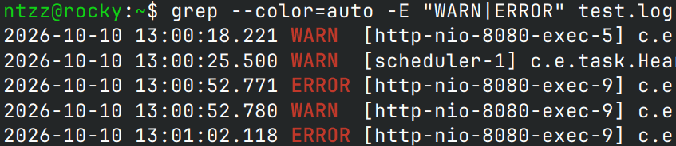

## `sed` **编辑**

### 空间

- 模式空间

  **默认工作区**。`sed`每读一行文本，先放到这里，执行 `s///`、`d`、`p` 等常规命令，处理完默认输出。**每行都会刷新**，读下一行时，模式空间会被新行替换（除非用`N`追加）。

- 保持空间

  **临时存放区**，默认是空的，**不会自动刷新**，专门用来存内容，在多行处理、两行对比、交换行、跨行拼接的时候用。

### 语法

- 基本语法

  ```bash
  #"选项"非必需，但必须有"命令脚本"
  sed [选项] '脚本' 文件名  #如不写文件名从，就从"stdin"读取
  ```

- 选项

  | <center>符号</center> | <center>含义</center>            |
  | :-------------------: | -------------------------------- |
  |         `-n`          | 抑制默认输出，只输出显式`p`的行  |
  |         `-E`          | 启用扩展正则表达式               |
  |         `-i`          | 原地修改文件                     |
  |       `-i.bak`        | 原地修改，并备份为`.bak`         |
  |         `-e`          | 指定一条脚本，可重复用于多条脚本 |

- 命令

  | <center>字母</center> | <center>含义</center>                     |
  | :-------------------: | ----------------------------------------- |
  |          `p`          | print，打印当前行                         |
  |          `P`          | 打印模式空间第一行（到第一个换行）        |
  |          `d`          | delete，删除当前行（不输出）              |
  |          `D`          | 删除模式空间第一行，然后重新执行脚本      |
  |          `s`          | substitute，替换，格式 `s/查找/替换/标志` |
  |    `s/查找/替换/g`    | 替换标志：一行内全局替换                  |
  |          `N`          | 读入下一行，与当前行用 `\n` 合并          |
  |          `=`          | 打印行号                                  |

- 空间命令

  | <center>命令</center> | <center>含义</center>                                                       |
  | :-------------------: | --------------------------------------------------------------------------- |
  |          `h`          | 覆盖：把**模式空间**内容 → ***复制***到**保持空间**，***覆盖***保持空间内容 |
  |          `H`          | 追加：把**模式空间**内容 → ***追加***到**保持空间**，前面加换行             |
  |          `g`          | 覆盖：把**保持空间**内容 → ***复制***到**模式空间**，***覆盖***模式空间内容 |
  |          `G`          | 追加：把**保持空间**内容 → ***追加***到**模式空间**，前面加换行             |
  |          `x`          | 交换：**模式空间**和**保持空间**内容互换                                    |

- 地址与锚点

  | <center>符号</center> | <center>含义</center>                     |
  | :-------------------: | ----------------------------------------- |
  |      `/pattern/`      | 正则地址，匹配该模式的行                  |
  |        `1,10`         | 行号范围                                  |
  |          `$`          | 地址：最后一行；正则中：行尾锚点          |
  |          `^`          | 正则中：行首锚点                          |
  |         `1~2`         | 步长地址：从 1 开始每隔 2 行              |
  |          `!`          | 地址取反（如 `$!` = 非最后一行）          |
  |       `{ ... }`       | 命令块，把多条命令作用于同一地址          |
  |       `\(...\)`       | 捕获组（基本正则写法），分组捕获匹配内容  |
  |        `(...)`        | 捕获组（扩展正则写法），需配合 `-E` 使用  |
  |      `\1` ~ `\9`      | 反向引用，替换中引用第 1~9 个捕获组的内容 |

### 基本输出

- 默认输出

  `sed`后面执行空脚本，即运行`sed`的**默认**流程：打印文件每一行。

  ```bash
  # "sed"默认流程：
  # 1.读取一行，存放到模式空间
  # 2.执行脚本命令
  # 3.自动打印模式空间内容
  # 4.清空模式空间，读取下一行
  sed '' 文件名  #执行"sed"的默认流程
  ```

  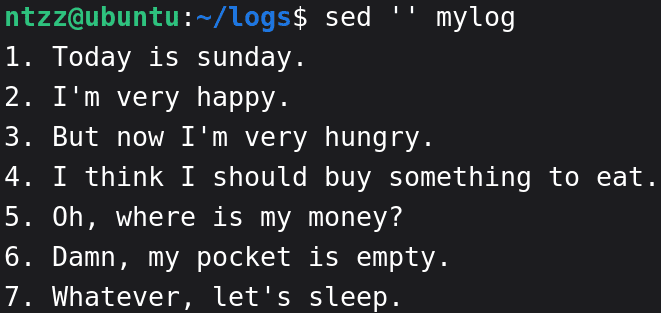

- 默认输出`+`脚本输出

  ```bash
  #sed本身具有"打印每一行"的功能，脚本'p'又会打印一次，因此会打印两次
  sed 'p' 文件名
  ```

  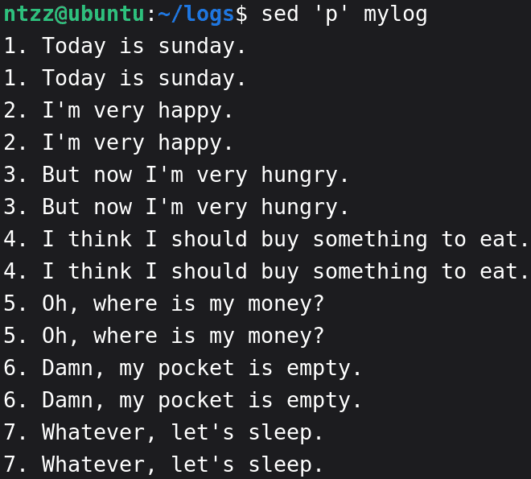

- 抑制默认输出

  ```bash
    #sed本身"打印每一行"的功能被"-n"抑制，只有脚本'p'打印。
    sed -n 'p' 文件名
  ```

  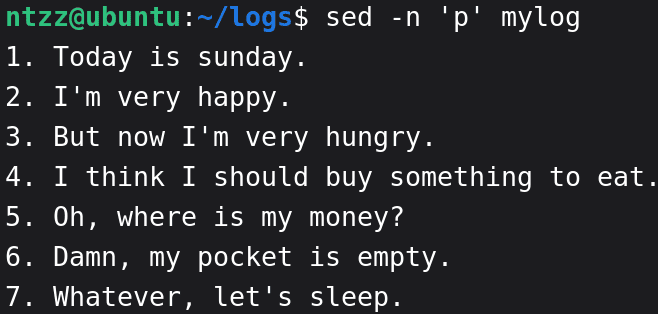

- 按行输出
  - 输出`第N`行

    ```bash
    sed -n 'Np' 文件名
    ```

    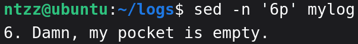

  - 输出`范围`行

    ```bash
    sed -n '起始数字,结束数字p' 文件名
    ```

    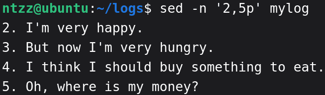

  - 输出最后一行

    ```bash
    sed -n '$p' 文件名
    ```

    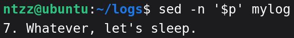

### 进阶输出

- 正则

  范例：输出时去掉匹配的行

  ```bash
  #"d"表示在输出时去掉匹配行，不会删除源文件的匹配行
  #以下4种写法效果相同
  sed '/基本正则/d' 文件名
  sed -E '/扩展正则/d' 文件名
  sed -n '/基本正则/!p' 文件名
  sed -nE '/扩展正则/!p' 文件名  #"!"代表对"/正则地址/"取反
  ```

  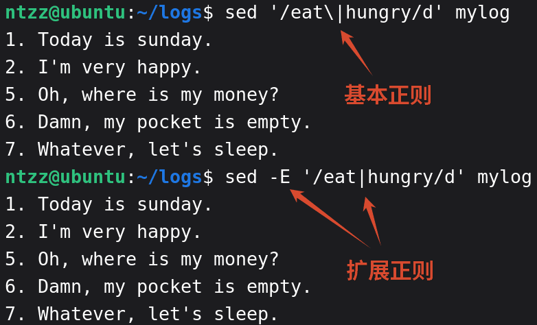

  如上图所示，正则的含义为：包含**eat**或**hungry**的行，最终结果为不显示这些行。

- 匹配替换

  匹配替换用来替换所有匹配的内容。

  ```bash
  #全局标志"g"如果不写，则只替换所有匹配行的第一行，如写则替换所有匹配行
  sed 's/替换前正则/替换后正则/[g]' 文件名
  ```

  如下图所示，脚本使用了`-g`全局标志，因此所有的**is**都被替换为**gogogo**。

  ![sed 's/源文本/替换文本/[g]' 文件名](./Images/sed-s-g.png)

  如下图所示，`^`在正则中表示**行首**，用`▷ `替换了行首。

  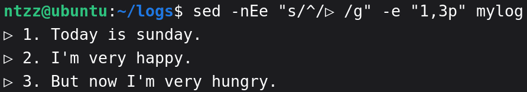

- 组合

  ```bash
  #两种方法效果相同
  sed -e '脚本1' -e '脚本' …… 文件名
  sed -e '脚本1;脚本2;脚本3……' 文件名
  ```

  下图用两种方法将`I`替换为`suyang`，将`my`替换为`suyang's`。

  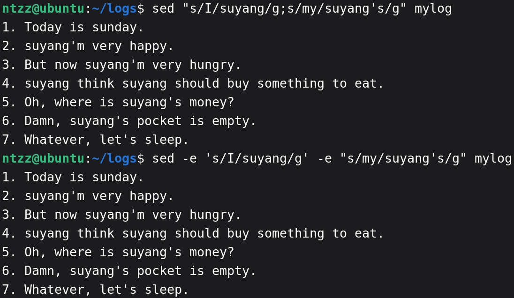  
  如上图所示，`-e`可以组和多个脚本。由于`suyang's`包含单引号，所以外部用双引号进行包裹。

- `捕获组`和`反向引用`

  **捕获组**和**反向引用**是成对出现的，因为**捕获组**的代码都在前面，**反向引用**的代码都在后面，因此叫**反向**。

  ```bash
  #捕获组用圆括号包裹：()
  #用"\1"、"\2"依次反向引用捕获组
  sed -E "s/(正则捕获组1)...(正则捕获组2).../...\1...\2.../"
  ```

  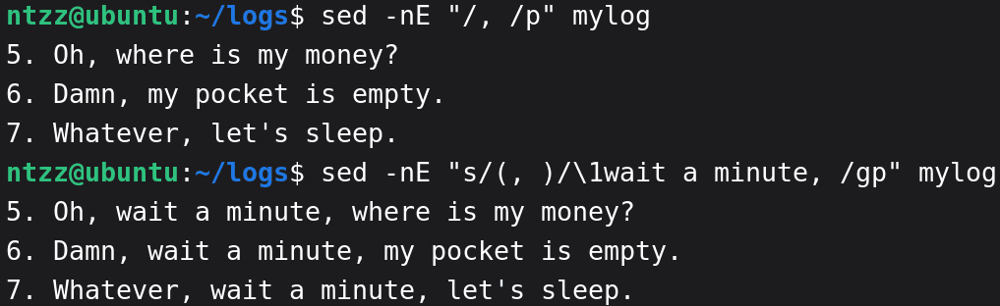  
  如上图所示，用捕获组捕获`, `，替换时用`\1`反向引用`, `，再加上`wait a minute, `。

- 区间

  ```bash
  sed -n '/起始正则/,/结束正则/p' 文件名
  ```

  下图打印了从吃到睡的所有行。

  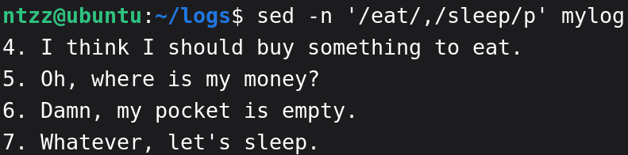

- 插入<span style="color: gray; margin: 0 2px">-</span>追加<span style="color: gray; margin: 0 2px">-</span>整行替换
  - 插入
    **插入**的位置都在行的前面。

    ```bash
    #"i"代表插入
    #在[行号]所在行上方插入内容
    #如果不写[行号]，则每一行上方都会插入内容
    #[行号]可以用"$"表示最后一行
    sed '[行号]i\插入内容' 文件名

    #在范围行的上方插入内容
    sed '[起始行号],[结束行号]i\插入内容' 文件名
    ```

    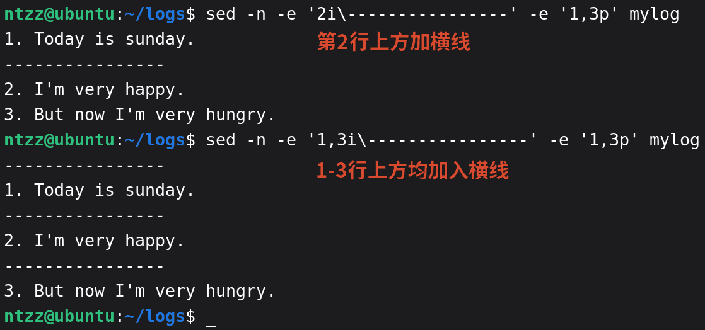

  - 追加
    
    ```bash
    sed '[行号]a\追加内容' 文件名
    ```

    **追加**的位置都在行的后面，语法与插入一致，此处不再赘述。

  - 整行替换

    ```bash
    #凡是一行内匹配到正则，都会被整行替换
    sed '/匹配正则/c\替换内容' 文件名
    ```

    如下图所示，将包含**money**的行整体替换为`💲💲💲💲💲`：

    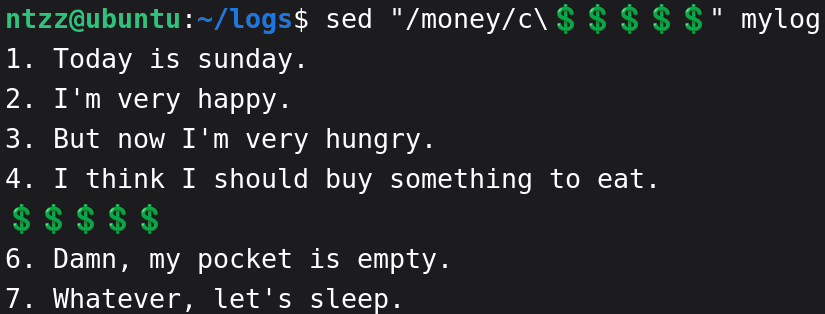

## `awk` **计算**
